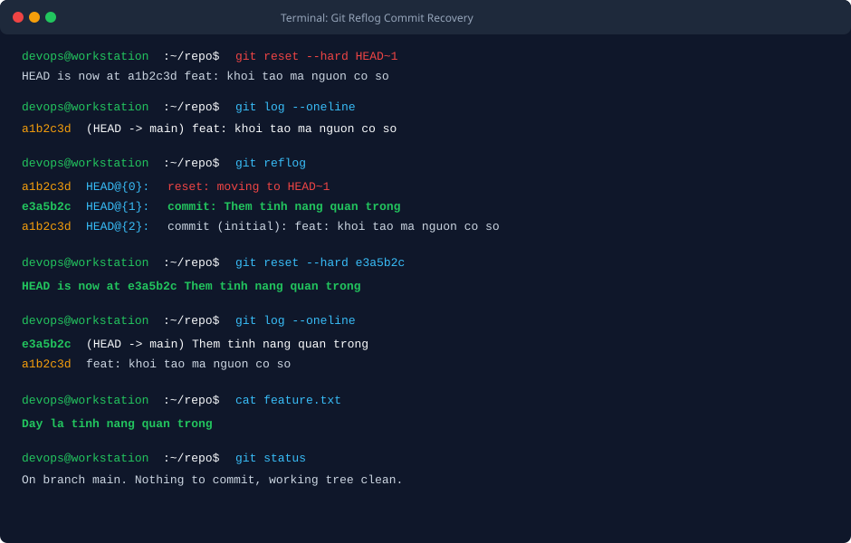
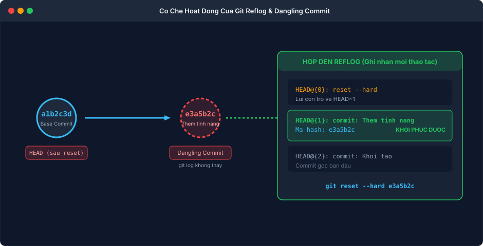

BÀI TẬP 1: KHÔI PHỤC COMMIT ĐÃ MẤT BẰNG GIT REFLOG

I. MỤC TIÊU BÀI TẬP

1. Nắm vững bản chất cơ chế lưu vết hoạt động cục bộ (Reference Logs - Reflog) của hệ thống quản lý phiên bản Git.
2. Hiểu rõ sự khác biệt giữa git log (chỉ duyệt theo chuỗi commit của nhánh hiện tại) và git reflog (ghi nhận mọi thay đổi vị trí của con trỏ HEAD trên máy trạm).
3. Tái hiện tình huống sự cố thực tế: vô tình chạy lệnh git reset --hard HEAD~1 khiến commit quan trọng chứa mã nguồn vừa làm việc bị biến mất hoàn toàn khỏi git log và cây thư mục làm việc.
4. Khai thác lệnh git reflog để định vị chính xác mã băm (commit hash) của commit bị cô lập (Dangling Commit).
5. Thực hiện khôi phục thành công toàn bộ mã nguồn và lịch sử commit mà không cần phải viết lại mã thủ công.


II. BỐI CẢNH VÀ THÔNG SỐ CẤU HÌNH

1. Tên kho lưu trữ: repo-reflog-demo
2. Tệp tin tính năng: feature.txt
3. Nội dung tệp tin: Day la tinh nang quan trong
4. Nhánh làm việc: main
5. Commit gốc ban đầu: a1b2c3d (feat: khoi tao ma nguon co so)
6. Commit bị xóa nhầm: e3a5b2c (Them tinh nang quan trong)
7. Lệnh gây sự cố: git reset --hard HEAD~1
8. Lệnh tra cứu cứu hộ: git reflog
9. Lệnh phục hồi trạng thái: git reset --hard e3a5b2c


III. CÁC BƯỚC THỰC HIỆN CHI TIẾT

1. Bước 1: Khởi tạo dự án thử nghiệm và commit tính năng quan trọng

Tạo thư mục dự án, khởi tạo Git và tạo commit gốc ban đầu:

```bash
mkdir -p repo-reflog-demo
cd repo-reflog-demo
git init
echo "Phien ban 1.0" > app.txt
git add app.txt
git commit -m "feat: khoi tao ma nguon co so"
```

Tiếp tục tạo tệp feature.txt chứa mã nguồn quan trọng và thực hiện commit thứ hai:

```bash
echo "Day la tinh nang quan trong" > feature.txt
git add feature.txt
git commit -m "Them tinh nang quan trong"
```

2. Bước 2: Tái hiện sự cố mất commit bằng lệnh reset hard

Trong quá trình thao tác, học viên vô tình thực hiện lùi commit và xóa sạch thư mục làm việc bằng cờ --hard:

```bash
git reset --hard HEAD~1
```

Hệ thống thông báo con trỏ HEAD đã bị lùi về commit trước đó:

```text
HEAD is now at a1b2c3d feat: khoi tao ma nguon co so
```

3. Bước 3: Kiểm tra trạng thái và xác nhận commit đã biến mất

Chạy lệnh kiểm tra lịch sử commit thông thường:

```bash
git log --oneline
```

Đầu ra thực tế:

```text
a1b2c3d (HEAD -> main) feat: khoi tao ma nguon co so
```

Commit Them tinh nang quan trong hoàn toàn biến mất khỏi danh sách lịch sử.
Kiểm tra tệp tin trên ổ đĩa:

```bash
ls -l
```

Tệp feature.txt đã bị xóa khỏi Working Directory. Nếu không nắm vững cơ chế Git, lập trình viên sẽ lầm tưởng dữ liệu đã bị mất vĩnh viễn.

4. Bước 4: Tra cứu nhật ký con trỏ HEAD bằng lệnh git reflog

Lệnh git log chỉ duyệt qua các commit có thể tiếp cận được (reachable) từ nhánh hiện tại. Trong khi đó, git reflog đóng vai trò như hộp đen ghi lại từng chuyển động của HEAD trên máy cục bộ.
Chạy lệnh tra cứu:

```bash
git reflog
```

Đầu ra ghi nhận chi tiết:

```text
a1b2c3d HEAD@{0}: reset: moving to HEAD~1
e3a5b2c HEAD@{1}: commit: Them tinh nang quan trong
a1b2c3d HEAD@{2}: commit (initial): feat: khoi tao ma nguon co so
```

Phân tích kết quả:
- Dòng HEAD@{0} ghi nhận hành động reset vừa khiến chúng ta mất commit.
- Dòng HEAD@{1} chỉ ra ngay trước khi reset, con trỏ HEAD từng trỏ tới commit có mã hash e3a5b2c với thông điệp Them tinh nang quan trong.
- Đây chính là chìa khóa để khôi phục mã nguồn.

5. Bước 5: Khôi phục commit đã mất về nhánh hiện tại

Sử dụng lại lệnh git reset --hard nhưng trỏ đích danh tới mã hash e3a5b2c vừa tìm được từ reflog:

```bash
git reset --hard e3a5b2c
```

Hệ thống lập tức đưa con trỏ HEAD và cây thư mục trở lại đúng trạng thái trước khi bị sự cố:

```text
HEAD is now at e3a5b2c Them tinh nang quan trong
```


IV. KIỂM TRA VÀ XÁC MINH HỆ THỐNG

1. Lệnh 1: Kiểm tra lịch sử commit sau khi cứu hộ

```bash
git log --oneline
```

Đầu ra thực tế xác nhận commit đã quay trở lại vị trí dẫn đầu nhánh main:

```text
e3a5b2c (HEAD -> main) Them tinh nang quan trong
a1b2c3d feat: khoi tao ma nguon co so
```

2. Lệnh 2: Kiểm tra nội dung tệp tin đã được phục hồi trên đĩa

```bash
cat feature.txt
```

Nội dung in ra nguyên vẹn 100 phần trăm:

```text
Day la tinh nang quan trong
```

3. Lệnh 3: Kiểm tra trạng thái cây làm việc

```bash
git status
```

Đầu ra ghi nhận nhánh sạch sẽ, không có lỗi tồn đọng:

```text
On branch main
nothing to commit, working tree clean
```


V. HÌNH ẢNH MINH HỌA VÀ NHẬT KÝ THAO TÁC

1. Terminal phát hiện mất commit, tra cứu git reflog và cứu hộ thành công



2. Sơ đồ cơ chế hoạt động của Git Reflog và vùng Dangling Commit



3. Nhật ký phiên làm việc kiểm tra từ Terminal

```text
devops@workstation:~/repo$ git reset --hard HEAD~1
HEAD is now at a1b2c3d feat: khoi tao ma nguon co so
devops@workstation:~/repo$ git log --oneline
a1b2c3d (HEAD -> main) feat: khoi tao ma nguon co so
devops@workstation:~/repo$ git reflog
a1b2c3d HEAD@{0}: reset: moving to HEAD~1
e3a5b2c HEAD@{1}: commit: Them tinh nang quan trong
a1b2c3d HEAD@{2}: commit (initial): feat: khoi tao ma nguon co so
devops@workstation:~/repo$ git reset --hard e3a5b2c
HEAD is now at e3a5b2c Them tinh nang quan trong
devops@workstation:~/repo$ git log --oneline
e3a5b2c (HEAD -> main) Them tinh nang quan trong
a1b2c3d feat: khoi tao ma nguon co so
devops@workstation:~/repo$ cat feature.txt
Day la tinh nang quan trong
devops@workstation:~/repo$ git status
On branch main
nothing to commit, working tree clean
```


VI. HƯỚNG DẪN NỘP BÀI GITHUB

1. Đường dẫn trên GitHub: homework/session_05/ex1/ (hoặc Session05/BT1/)
2. Cơ chế nộp: Tệp tin feature.txt và tệp báo cáo README.md mô tả chi tiết các bước từ khi phát hiện mất commit, tra cứu reflog đến khi khôi phục thành công bằng lệnh reset kèm hình ảnh minh chứng.


VII. KẾT LUẬN VÀ BÀI HỌC KINH NGHIỆM

1. Bản chất kiến trúc của Git là cơ sở dữ liệu đối tượng bất biến (Immutable Object Store). Khi thực hiện reset hard hoặc xóa một nhánh, Git không lập tức tiêu hủy commit mà chỉ ngắt liên kết tham chiếu (Reference pointer), đưa commit đó vào trạng thái mồ côi (Dangling Commit).
2. Reflog đóng vai trò như phao cứu sinh an toàn số một cho lập trình viên trên môi trường cục bộ. Mọi hành động commit, rebase, merge, reset hay checkout đều được ghi lại đầy đủ và lưu trữ mặc định từ 30 đến 90 ngày trước khi tiến trình dọn rác (git gc) can thiệp.
3. Kỹ năng sử dụng git reflog giúp kỹ sư DevOps bình tĩnh xử lý các tình huống ngộ nhận mất dữ liệu, tự tin thử nghiệm các kỹ thuật thao tác nhánh nâng cao mà không lo sợ làm tổn hại mã nguồn dự án.
